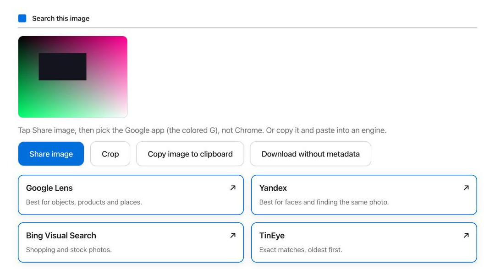

# Free Reverse Image Search

**[Try it: freereverseimagesearch.netlify.app](https://freereverseimagesearch.netlify.app)**

Search one image across Google Lens, Yandex, Bing and TinEye at once, see what the file
itself reveals (EXIF, GPS, AI-generation labels, hidden QR codes), and fingerprint it with
three perceptual hashes.

Free, no account, no ads, and **nothing is uploaded**. The whole tool is one HTML file that
does its work in your browser. That claim is the reason this repo exists: you can read the
file yourself and confirm there is no upload path, which is not something a hosted tool can
offer you.



## Use it for

- [Checking a dating profile photo for catfishing](https://freereverseimagesearch.netlify.app/check-dating-profile-photo)
- [Checking rental and marketplace listing photos for scams](https://freereverseimagesearch.netlify.app/check-rental-listing-photos)
- [Finding the original source of an image](https://freereverseimagesearch.netlify.app/find-original-source-of-image)
- [Asking whether an image is AI generated](https://freereverseimagesearch.netlify.app/is-this-image-ai-generated), and what you can actually check
- [Reverse searching on an iPhone](https://freereverseimagesearch.netlify.app/reverse-image-search-on-iphone)
- [Reverse searching a video](https://freereverseimagesearch.netlify.app/reverse-search-a-video), by picking one frame

## What it does

- **Four engines, one image.** Google Lens, Yandex, Bing Visual Search and TinEye. An image
  that is already online can go to all four at once.
- **Built for phones too.** Share the image straight into the Google app from the share
  sheet, or copy it and paste it into any engine on a desktop.
- **Crop before you search.** Cut out the face, product or logo you care about so the
  engines match that instead of the whole picture.
- **Video frames.** Pick a frame from a video with a slider; the video stays on your device.
- **EXIF and GPS.** Camera, lens, timestamps, editing software and location, parsed from the
  raw bytes with no library. Flags whether a photo carries a location and whether it was
  last saved by editing software rather than a camera.
- **C2PA Content Credentials.** Says whether a file declares itself AI generated, what made
  it, and whether it declares an invisible watermark. It reads the record and does not
  verify the signature, and a file with no record is not thereby genuine.
- **QR codes inside the image.** Decodes any QR code it finds and shows where it leads,
  because scammers paste fake ones onto parking meters and into messages.
- **Download without metadata.** Saves a clean copy with the EXIF and GPS removed.
- **Perceptual hashes.** aHash, dHash and pHash (with a hand-rolled DCT), so you can tell
  whether two images are the same picture after resizing or recompression.
- One file, no build step, no dependencies, no server.

## The design constraint that shaped everything

Reverse image search engines have to be able to **fetch the image themselves**. That
splits the problem in two:

- **An image already on the web** has a URL, so it can be handed straight to all four
  engines. This path works completely.
- **A file on your computer or phone** has no public address. The usual solution is to
  upload it to a server so the engines can reach it, which means hosting costs, storage,
  and responsibility for whatever strangers upload. This tool refuses that trade: it hands
  the image back to you to share or paste into the engine yourself.

That choice is why there is no backend, no database, no bill, and no moderation problem.

## What it cannot do

It does not have its own image index, so it cannot answer "where else does this appear"
on its own. That capability belongs to Google, Yandex and TinEye, who spent 15+ years and
many millions building crawled indexes of billions of images. This tool is a good front
end to theirs, plus analysis they don't give you.

## Analytics

**Only the hosted site counts anything. A copy you download and run yourself sends
nothing**: analytics start only on `https://freereverseimagesearch.netlify.app`, so a copy
opened from disk, a local server or a preview link never loads PostHog at all.

On the hosted site it reports counts to PostHog, and is deliberately narrow about it
because the whole pitch here is privacy:

- **Session recording is disabled.** It would record people's images on screen.
- **Autocapture is disabled.** It would collect the contents of the URL field.
- **The query string is stripped** off every URL-shaped property before anything is sent,
  via `sanitize_properties`. This one is not optional: the page accepts `?url=<image>`, so
  the address bar literally contains the image being searched.

What is left is counts and booleans: pageviews, which buttons get pressed, whether an image
arrived from a file or a URL, and whether it had EXIF, GPS or an editing-software tag.
**No filenames, no image addresses, and no EXIF values are ever sent.**

Visiting `/#internal` opts a device out permanently (`/#public` undoes it).

## Tests

```bash
./tests/run.sh
```

Everything is verified against independent reference implementations, and the tests
extract the real code out of `index.html` so they cannot drift from what ships.

- **EXIF** is checked against a fixture whose bytes are hand-assembled in
  `tests/make_fixtures.py`, so every expected value is known exactly. Covers ASCII,
  SHORT, LONG and RATIONAL types, both sub-IFDs, and GPS degrees/minutes/seconds to
  decimal conversion. Also covers the failure paths: no EXIF, non-JPEG, empty buffer,
  and a truncated file (which must not throw).
- **Hashes** are compared bit for bit against a separate Python implementation, fed the
  identical grayscale pixel arrays so the test measures the algorithm rather than two
  different resamplers.

  Expect the hashes the browser prints to differ by a few bits from the ones the tests
  print. That is not a bug: a canvas downscale and Pillow's `BILINEAR` are not the same
  filter, so they hand slightly different pixels to an identical algorithm. What matters
  is that distances between images stay stable, which is what the robustness test checks.
- **Robustness** measures real Hamming distances across real edits.

Measured behaviour of pHash (distance from the original, 0 = identical):

| Edit | pHash | dHash |
|---|---:|---:|
| Resized to 25% | 0 | 0 |
| Resized to 200% | 0 | 0 |
| JPEG quality 20 | 0 | 1 |
| Brightness +25% | 0 | 2 |
| Converted to grayscale | 0 | 2 |
| Cropped 5% off each edge | 2 | 4 |
| Rotated 90 degrees | 24 | 8 |
| A genuinely different image | 32 | 46 |

**Known limitation: rotation defeats it.** A 90 degree turn reads as a different image.
That is inherent to how these hashes work, not a bug, but it means you should rotate an
image back before comparing.

## Running it yourself

Open `index.html` directly, or serve it:

```bash
python3 -m http.server 8765
# then open http://localhost:8765/
```

Clipboard write may be restricted on `file://` in some browsers, which is the only reason
to bother with the server.

## Files

```
index.html              the entire tool
favicon.svg             favicon source (also inlined into index.html)
tests/run.sh            runs everything
tests/make_fixtures.py  builds test-exif.jpg with a hand-built EXIF block
tests/test_exif.mjs     EXIF parser assertions
tests/test_hash.mjs     hash cross-check against Python
tests/test_c2pa.mjs     Content Credentials reader, incl. malformed files
tests/fixture-c2pa-chatgpt.png  a real C2PA-labelled image used by that test
tests/test_robustness.py  Hamming distances across real edits
```

`test-exif.jpg` and `_base.jpg` are generated by the tests and can be deleted.

## Deploying

`publish/` holds exactly what goes on the web: the page, the guides, the icons,
`robots.txt`, `sitemap.xml` and `_headers`. The test fixtures and test suite deliberately
stay out of it.

```bash
cp index.html favicon.svg publish/
netlify deploy --prod --dir=publish
```

Icons are generated from the same geometry as `favicon.svg`:

```bash
python3 tools/make-icons.py
```

## License

MIT. Do what you like with it.
